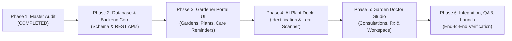

# FarmsKing – Gardener & Garden Doctor Implementation Roadmap

**Document**: `docs/DEVELOPMENT_PHASE_PLAN.md`  
**Generated Date**: 2026-11-23  
**Status**: Proposal Pending Owner Approval (Audit Phase)  

---

## 1. Phased Execution Sequence

---

## 2. Phase Breakdown & Deliverables

### Phase 1: Complete Technical Inspection & Audit (CURRENT PHASE)
- **Status**: **COMPLETE**.
- **Deliverables**: 9 comprehensive audit reports generated without altering source code or database records.

### Phase 2: Database Schema & Core Services (Requires Approval)
- Update `backend/prisma/schema/` to make `Plant.gardenId` optional and introduce `PlantCareSchedule` and `AiCreditLedger`.
- Run safe non-destructive migration (`prisma migrate dev`).
- Implement NestJS `GardensService` and `GardenDoctorService` with unit tests.

### Phase 3: Gardener Portal Web UI
- Build the dedicated Gardener Portal in `frontend/app/(user)/(tabs)/garden/`.
- Garden visual cards: Balcony, Terrace, Indoor, and Standalone Pots.
- Plant profile view with watering, fertilizer, pruning schedules and expense trackers.

### Phase 4: AI Plant Doctor Calibration
- Create specialized prompt personas in Gemini AI service targeting domestic flora, houseplant pests, and organic remedies.
- Build mobile-optimized and desktop-optimized leaf camera scanner with image zoom and pathology report preview.

### Phase 5: Garden Doctor / Planner Workspace
- Build dedicated doctor consultation portal in `frontend/app/(partner)/garden-doctor/`.
- Client triage queue, plant history inspection, digital prescription generation, and payout tracking.

### Phase 6: QA Verification & Release
- Verify all 18 QA test accounts against new endpoints.
- Ensure 100% zero layout shift on laptop/PC viewports.
- Local verification first before any live production deployment command.
