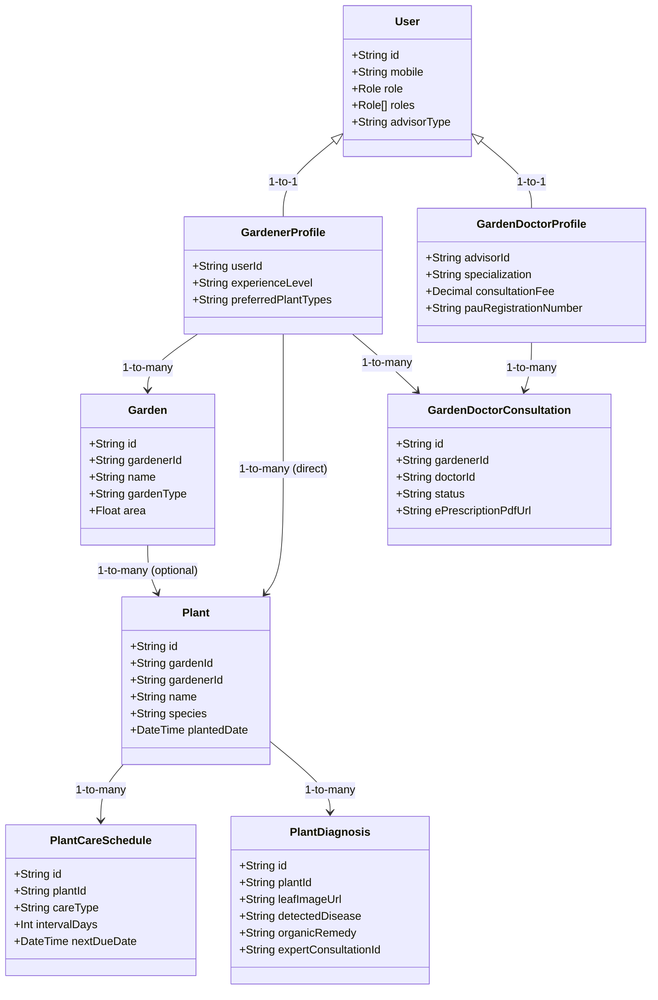

# FarmsKing – Proposed Target Architecture (Gardener & Garden Doctor)

**Document**: `docs/PROPOSED_SYSTEM_ARCHITECTURE.md`  
**Generated Date**: 2026-11-23  
**Status**: Proposal for Owner Review & Approval (Audit Phase)  

---

## 1. Domain Separation & Role Hierarchy

---

## 2. API Architecture & New Endpoints

### 2.1 Gardener Portal (`/api/v1/gardens`)
- `GET /api/v1/gardens`: List user gardens with vitality summaries.
- `POST /api/v1/gardens`: Create garden (Balcony, Terrace, Indoor, Backyard).
- `GET /api/v1/gardens/:id`: Detailed view of a garden including its plants and upcoming care alerts.
- `GET /api/v1/gardens/plants/standalone`: Retrieve plants not bound to a garden.
- `POST /api/v1/gardens/plants`: Add plant (supports `gardenId` or `standalone: true`).
- `POST /api/v1/gardens/plants/:id/care-log`: Record watering, feeding, pruning, or repotting.
- `GET /api/v1/gardens/expenses`: Unified expense ledger for soil, pots, and tools.

### 2.2 AI Plant Doctor (`/api/v1/plant-ai`)
- `POST /api/v1/plant-ai/identify`: Identify plant species from leaf or flower photograph.
- `POST /api/v1/plant-ai/diagnose`: Detect pathogen, pest infestation, or nutrient deficiency with organic household remedies.
- `GET /api/v1/plant-ai/credits`: Retrieve remaining diagnostic scan allowance.

### 2.3 Garden Doctor / Planner (`/api/v1/garden-doctor`)
- `GET /api/v1/garden-doctor/directory`: Browse verified urban horticulturists and garden designers.
- `POST /api/v1/garden-doctor/consultations`: Book consultation (SOS triage, seasonal care pass).
- `GET /api/v1/garden-doctor/workspace`: Doctor portal managing active assigned clients, reviewing plant photo history, and issuing digital e-prescriptions.

---

## 3. Storage, Telemetry & Scalability Plan

1. **Plant Photo Storage**: Stored on Cloudflare R2 / S3 via pre-signed upload URLs. Thumbnail generation (200x200) for timeline views and full-resolution (1280px) for AI vision diagnosis.
2. **Push & WhatsApp Reminders**: Integrated with existing Notification microservice. Reminds users of morning watering windows or fertilizer cycles based on local weather telemetry.
3. **Multi-Platform UI**: 100% pure React Native Web implementation responsive across laptop/PC viewports (primary priority) and mobile viewports.
