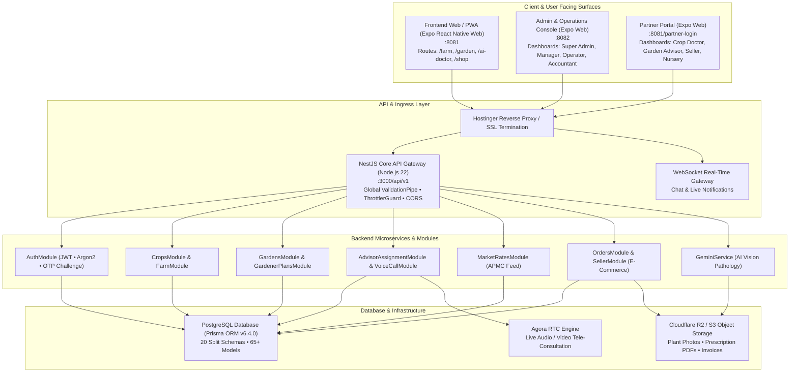

# FarmsKing – Master Technical Audit & Architecture Review

**Document**: `docs/TECHNICAL_AUDIT_REPORT.md`  
**Generated Date**: 2026-11-23  
**Auditor**: Senior Software Architect & Security Engineer Panel  
**Target Entity**: FARMSKING TECHNOLOGIES PRIVATE LIMITED  
**Scope**: Full-stack code inspection, database schema, role models, security, and integration compatibility for the planned Gardener Portal & Garden Doctor / Planner.

---

## 1. Executive Summary

FarmsKing is an enterprise-scale agritech and rural commerce platform engineered as a modular monorepo. It serves three distinct clienteles:
1. **Commercial Cultivators & Farmers**: Crop cycle tracking, Sentinel-2 satellite foliar telemetry, digital bahi-khata, daily APMC mandi wholesale rates, and precision spray calculations.
2. **Professional Partners**: Certified Agronomists (Crop Doctors), Garden Advisors, Certified Agri Input Dealers, Nursery Owners, and Business Sales Agents.
3. **Institutional Operations**: Platform Administrators, Operations Managers, Field Support Operators, Accountants, and Technical Trainers.

The objective of this audit is to inspect every existing architectural layer before introducing a structured **Gardener Portal** and **Garden Doctor / Garden Planner Professional System**, ensuring zero regression across the existing Farmer Portal, Customer Portal, Admin Panel, and Partner systems.

---

## 2. Project Architecture Map

---

## 3. Technology Stack & Framework Audit

### 3.1 Frontend Web (`/frontend`)
- **Framework**: Expo SDK 52 / React Native 0.74 compiled to React Native Web (React 18.3.1).
- **Routing**: Expo Router v3 file-based routing (`frontend/app/`).
- **Styling**: Pure React Native StyleSheet with custom design tokens (`THEME`, `RADIUS`, `FONT`), high-contrast dark obsidian (`#070c18`) and day themes, and CSS reset rules embedded in `frontend/app/+html.tsx`.
- **Animations**: `react-native-reanimated` hardware-accelerated transitions and layout-shift guards.
- **State Management**: React Context providers (`AuthContext`, `CropsContext`, `ThemeContext`, `CartContext`).
- **Networking**: Axios instance (`frontend/src/api/apiClient.ts`) with bearer token injection and standard 401 interception.

### 3.2 Admin Portal (`/admin`)
- **Framework**: Expo React Native Web / Vite bundler targeting modern desktop browsers.
- **Role Switching**: Centralized executive console allowing immediate switching between 16 active dashboard views for verified staff.
- **Theming**: Dedicated `ExecutiveThemeProvider` with audit contrast guards.

### 3.3 Backend Core (`/backend`)
- **Framework**: NestJS 10.x running on Node.js 22.
- **Database Access**: Prisma ORM v6.4.0 with PostgreSQL. Schema definitions are split modularly across 20 files in `backend/prisma/schema/*.prisma`.
- **Security & Guards**:
  - `ThrottlerGuard` for brute-force prevention on OTP and login routes.
  - `JwtAuthGuard` and `OptionalJwtAuthGuard`.
  - `RolesGuard` checking `@Roles(...)` metadata against authenticated user roles.
  - `PortalEligibility` checking dedicated admin vs client portal credentials.
- **Real-Time Communication**: Socket.io gateway for live messaging and Agora RTC token generation for voice consultations.

---

## 4. Key Findings & Baseline Status

1. **Dual System Foundation Already Present**: The database schema is not starting from scratch. It already includes foundational models for gardens (`Garden`, `Plant`, `GardenVisit`, `GardenExpense`, `GardenExpertPlan`, `GardenerPlan`).
2. **Current Structural Gaps**:
   - `Plant` requires a non-null `gardenId`. Standalone plants (e.g. potted plants without an assigned garden) cannot currently be created.
   - No dedicated AI credit ledger model exists for tracking plant pathology quota per user.
   - The Garden Advisor UI is currently merged into general advisor views rather than possessing an urban-focused clinic interface.
3. **Performance Baseline**:
   - All 10 backend test suites (68/68 unit and integration tests) pass cleanly.
   - Production bundle compiles with zero syntax errors.
